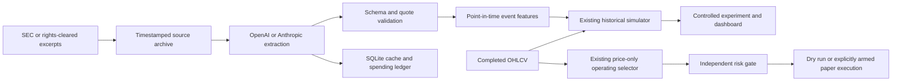

# Architecture and strategies

`data` validates daily OHLCV and computes backward-looking rolling indicators. `strategies` maps the same indicator frame to per-strategy exposure multipliers. `selector` ranks active candidates and normalizes weights. `risk` independently gates and sizes proposed orders. `research` simulates a portfolio, and `analytics` summarizes its performance. `execution` owns Alpaca paper integration and a SQLite order journal. `dashboard` exposes research and execution via Tkinter and the CLI.

| Strategy | Entry signal |
| --- | --- |
| Momentum | Positive 20-session momentum, relative strength, and sufficient volume |
| Mean reversion | Low RSI and a close below a rolling standard deviation band |
| Trend following | Price above its moving average, positive slope and directional strength |
| Breakout | Close above the prior 20-session high with volume confirmation |
| Pairs | Long the discounted equity against a benchmark relationship screened using Engle-Granger cointegration on prior data |
| Volatility adaptive | Positive trend below the realized-volatility cap, with ATR-adjusted exposure |

The pairs signal uses only the long leg. It does not hedge with a short position. Signals decay to a zero target when entry conditions or selector thresholds no longer pass. Available strategies and threshold overrides are configured in JSON.

The rule regime classifies trend direction and high volatility. The supplementary gradient-boosting classifier learns rule labels and is displayed alongside them, so it measures agreement with that baseline rather than predictive market-state accuracy. The strategy model uses a small gradient-boosted ensemble on causal price, volatility, strength and volume features plus strategy identity and entry exposure. It estimates open-to-open utility over up to five sessions after proportional entry and exit costs and an ex-ante volatility penalty, scaled by each strategy's entry exposure. Scores are return estimates. Each strategy label exits at the next open after its signal goes inactive or at the five-session boundary. Missing intervening or fill sessions invalidate the label. The label is a short-horizon proxy, distinct from the portfolio simulator's continuously resized positions. The rule selector and equal-weight benchmark offer simpler comparisons. Selection supports one or several strategies, abstention and a small switching buffer in backtests.

Walk-forward development folds follow calendar order. Training labels must finish before validation begins, and validation labels must finish within each fold. The final quarter is reserved for the comparison. No automatic tuning uses the final results. Backtests use next-open fills with deterministic slippage and fees, cash and position tracking, and close marks. A prior-session volume cap bounds strategy orders. Reductions are processed before increases and new targets share one opening equity snapshot. A configurable mark-gap limit aborts evaluation when a held symbol stops reporting data. Regime attribution uses the previous close's regime. The benchmark holds the configured benchmark equity, independent of strategy risk limits. Positions are marked, not liquidated, at the end. Attribution allocates realized sell P&L using a share-weighted strategy mix accumulated across the buys and is approximate. There is no capacity, partial-fill, queue priority or delisting model in the historical simulator.

Synthetic data verifies behavior only. Extended paper evaluation needs adjusted real data, a point-in-time universe, sensitivity analysis for costs and liquidity, out-of-sample model review and reconciliation checks on a dedicated paper account. A 60-second dashboard timer runs offline and dry-run analysis while enabled. Paper runs are individually armed. The dashboard displays available paper positions, cash, unrealized P&L and journal states. Mark-to-market realized P&L is available through the historical metrics and is not reconstructed from the live account.

## V3 research and account reads

`trading.quant` reports exchange-calendar coverage, reproduces V2, and runs frozen train/holdout studies. The research candidate fits a same-symbol, same-session relative utility residual only on overlapping development signals. It centers the predicted residual within eligible candidates and adds half to the absolute V2 estimate. Candidate identity is namespaced separately from market feature names. The deliberately preserved V2 comparator retains its feature-name collision to allow exact historical replay. The research candidate never enters the order path.

The analytical exposure-matched comparator rebalances SPY against the previous simulated close's portfolio exposure and charges proportional rebalancing costs. It has no executable order model. Paired block bootstrap intervals resample identical sessions for both methods and preserve cross-stock dependence in aggregate portfolio returns. Research commands do not instantiate an execution adapter.

`bot.py verify-paper` reads paper-account status and positions through the Alpaca SDK and returns only status, block state and position count. The automated test stubs the client. Download is a separate read-only path.

## V4 financial-event research boundary

Research and deployment model paths are separate. The research experiment reuses the V3 gradient booster and simulator. Only the model feature matrix differs in the primary ablation. The dashboard renders citations and extracted evidence as unverified interpretations. See [LLM research report](LLM_RESEARCH_REPORT.md).
