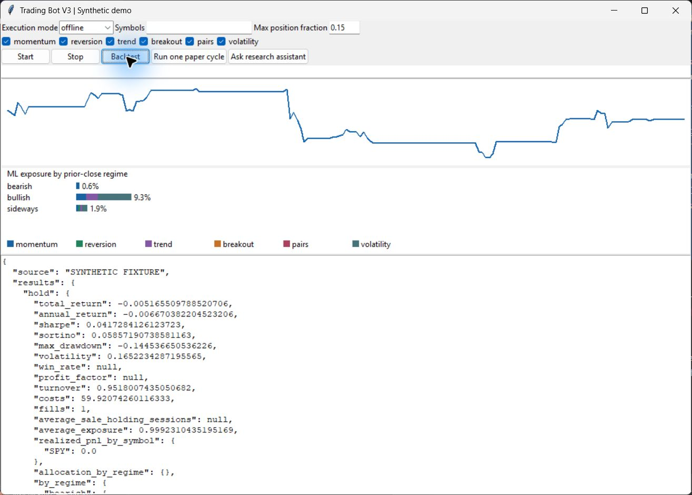
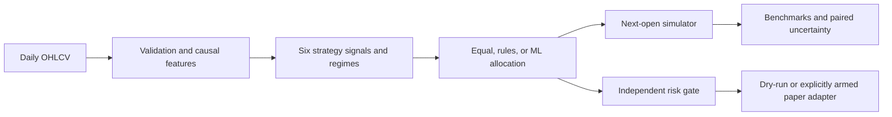
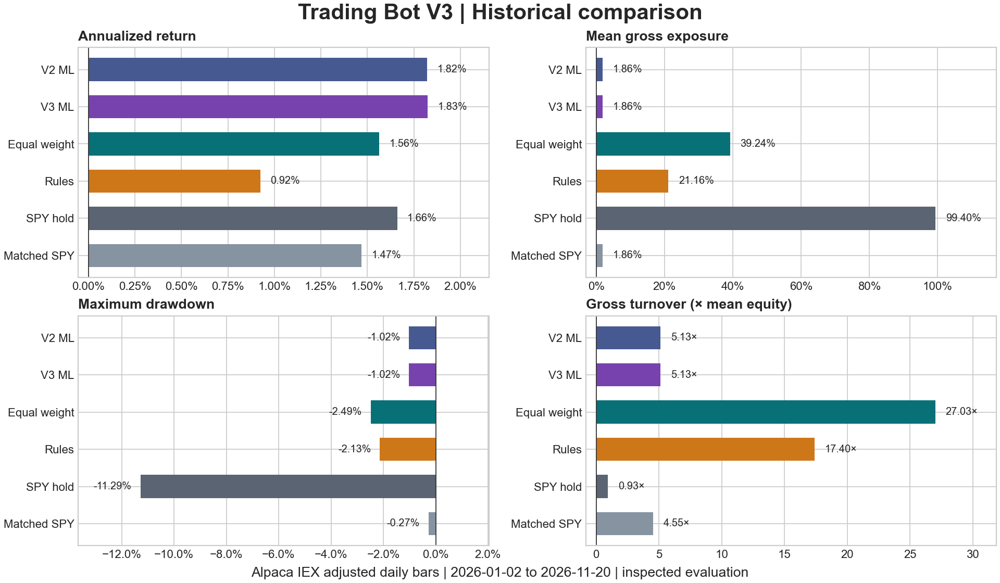
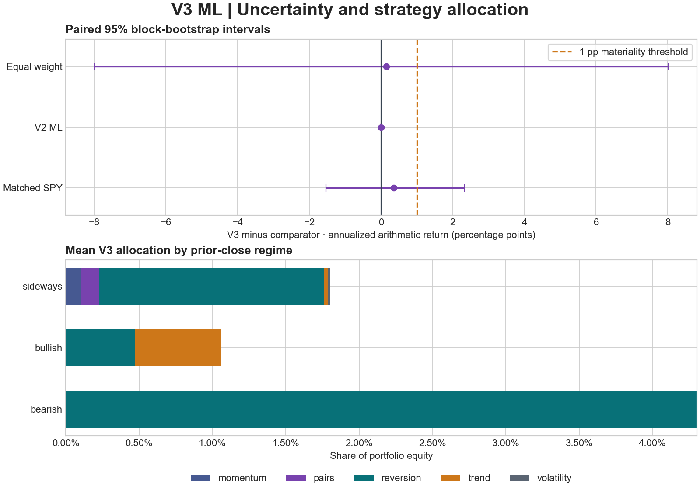

# Trading Bot V4

A Python research and paper-trading sandbox for a specific question: **does ML improve selection among six long-only equity strategies after trading costs?** The inspected studies did not establish a material advantage over equal weighting. The repository includes the simulator, model diagnostics, broker safeguards, and the evidence behind that finding.

## Run the offline demo

Install Python 3.12.7 with Tkinter. The constraints file records the verified research environment. From the repository root in PowerShell:

```powershell
python -m venv .venv
$py = ".\.venv\Scripts\python.exe"
& $py -m pip install -r requirements.txt -c constraints-v4.txt
& $py bot.py dashboard --synthetic --mode offline
& $py -m unittest discover -s tests -v
```

Click **Backtest** to see the equity curve, strategies allocated by regime, and detailed metrics. Use **Start** to inspect decision explanations on the latest synthetic bar. Synthetic results are labeled in the window and output.



## Architecture



Signals cover momentum, mean reversion, trend following, breakout, benchmark-relative long-only pairs, and volatility-adaptive exposure. The pairs signal carries long equity exposure without a short hedge. The supplementary regime classifier learns rule labels, so agreement measures how well it reproduces those labels. The baseline gradient booster estimates short-horizon net utility. The research ensemble adds a within-symbol relative-utility estimate where signals overlap. Both can abstain. The ensemble is evaluated offline and kept outside the order path.

### The V2 feature defect

The V2 feature matrix used `momentum`, `trend`, and `breakout` for both continuous price features and strategy indicators. Assigning the indicators silently replaced the continuous columns. V3 uses `strategy_*` names in the corrected research matrix. The legacy mapping is isolated and retained for exact V2 reproduction, including the existing operating selector. The corrected ensemble preserves the feature separation in its relative component, and the regression tests cover both mappings.

## Historical evaluation

Decisions use completed daily bars. Training labels begin at the next open, account for both cost legs, and are purged at the training boundary. Portfolio simulation uses next-open fills, position and cash checks, prior-volume limits, and explicit fees and slippage. The study compares annualized returns and risk using paired 10-session block bootstraps.





From January through November 2026, the V3 ensemble returned **1.83% annualized**, compared with **1.82% V2 ML**, **1.56% equal weight**, **0.92% rules**, **1.66% SPY buy-and-hold**, and **1.47% exposure-matched SPY**. The paired arithmetic advantage over equal weight was **+0.15 percentage points**, with a 95% interval of **−7.99 to +8.02 points**. Equal weighting led in the 2023 and 2024 walk-forward runs. The retrospective stock universe, revised price adjustments, and inspected 2026 period limit generalization. Simulated fills do not model auction queue priority or delisting proceeds.

## Reproduce the research

The local archive contains the exact market-data inputs and reports. A fresh clone can run the synthetic demo immediately. Historical results require a separately obtained data snapshot. Alpaca provider access and revised adjustments can change reconstructed results.

```powershell
& $py -m trading.quant study --data audit-runs/v3/alpaca.csv
& $py -m trading.quant compare --data audit-runs/v3/alpaca.csv
```

See the [quantitative research report](QUANT_RESEARCH_REPORT.md) for full commands, provenance, sensitivity analysis and limitations. The [portfolio audit](PORTFOLIO_AUDIT.md) records verification, and the [interview guide](INTERVIEW_PREP.md) summarizes the technical decisions.

## Alpaca and operational safety

Set paper credentials privately in the process environment. `bot.py verify-paper` reads status and positions. `bot.py download` reads history. Paper submission requires a local configuration opt-in and explicit arming. The independent risk gate checks cash, exposure, concentration where configured, losses, drawdown and quote freshness. A persistent SQLite journal blocks duplicate submissions and preserves unresolved intents after timeouts. The optional research assistant receives research metrics and regime context, without local journal, account, position or order fields. See [architecture notes](ARCHITECTURE.md).

## V4 financial intelligence and research

V4 adds an opt-in financial intelligence layer. The V3 trading, backtesting and paper-risk flows continue to work without LLM keys. The dashboard **Financial intelligence** button reads local events, study outputs and estimated API costs without contacting a provider or broker. LLM output is not connected to order decisions.

```powershell
$py = ".\.venv\Scripts\python.exe"
New-Item -ItemType Directory -Force llm-runs | Out-Null
& $py -m trading.llm_research study --synthetic --output llm-runs/fixture-study.json
& $py bot.py dashboard --synthetic --mode offline --llm-study-report llm-runs/fixture-study.json
```

For SEC collection, use your own descriptive SEC User-Agent contact. For appropriately licensed news, issuer earnings announcements and other disclosures, create equivalent JSON Lines source records. Each row needs `symbol`, `kind` (`news`, `earnings`, `disclosure` or `sec_filing`), canonical HTTPS `url`, timezone-aware `published_at` and `observed_at`, `rights`, and permitted excerpt `text`. Keep source files under `llm-runs/`.

```powershell
& $py -m trading.llm_research sec --symbol AAPL --cik 320193 --contact $env:SEC_CONTACT --output llm-runs/sec-sources.jsonl
& $py -m trading.llm_research extract --sources llm-runs/sec-sources.jsonl --output llm-runs/events.jsonl --settings llm.example.json --ledger llm-runs/usage.sqlite3 --allow-provider-processing
& $py bot.py dashboard --synthetic --mode offline --events llm-runs/events.jsonl --llm-ledger llm-runs/usage.sqlite3
```

Use `OPENAI_API_KEY` with the example configuration. For Anthropic, copy the example to `llm.local.json`, set provider to `anthropic`, model to `claude-haiku-5-5`, and set `ANTHROPIC_API_KEY` privately. Supply custom input and output token rates when choosing a model without a built-in rate. Send excerpts only when your access permits external processing. Missing credentials, expired events, malformed responses and rate limits do not affect quantitative execution.

A real study requires immutable event archives with their true timestamps and a locked future start. Use `python -m trading.llm_research study --data path/to/bars.csv --events path/to/events.jsonl --config config.v3.example.json --start YYYY-MM-DD`. V4 rejects the already-inspected V3 period and refuses to substitute synthetic results. See [the LLM research report](LLM_RESEARCH_REPORT.md) for analysis, cost estimates, and the reason a genuine LLM performance result is currently unavailable.

## Release candidate

See [the changelog](CHANGELOG.md) and [release verification](RELEASE_READINESS.md). The optional chart environment uses Matplotlib 3.10.6. The default offline workflows and CI require no market or LLM credentials.

## Research branch

The portfolio release is frozen at the local **v4.0.0-rc.1** tag. This branch adds [individual strategy analysis](STRATEGY_ANALYSIS.md), [allocation comparisons](ALLOCATION_RESEARCH.md), and a [sector-universe robustness study](UNIVERSE_ROBUSTNESS.md). Model settings and order execution are preserved. The [prospective evaluation](PROSPECTIVE_EVALUATION.md) is manual and non-executing. See the [future LLM evaluation plan](LLM_EVALUATION_PLAN.md) for a low-cost prospective data protocol.
